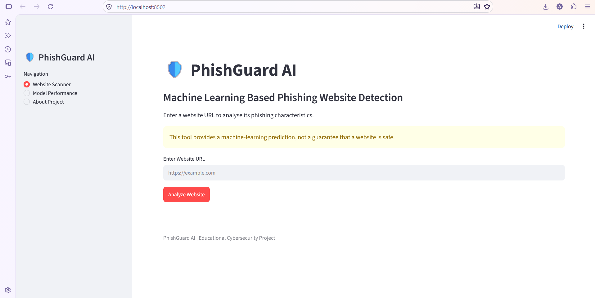

# 🛡️ PhishGuard AI – Phishing Website Detection

## Application Preview



## Project Overview

PhishGuard AI is a machine learning-based web application that identifies potentially phishing websites by analysing URL features.

The application uses a Random Forest Classifier to predict whether a URL is legitimate or potentially malicious.

## Features

- Website URL scanning
- Phishing probability prediction
- Legitimate and phishing classification
- Model performance dashboard
- Confusion matrix visualisation
- Feature importance analysis

## Technologies Used

- Python
- Pandas and NumPy
- Scikit-learn
- Random Forest Classifier
- Streamlit
- Matplotlib and Seaborn

## Dataset

**PhishTrap – Labelled URL Dataset**

Source: https://huggingface.co/datasets/saidutta69/PhishTrap

## Machine Learning Model

- Algorithm: Random Forest Classifier
- Number of decision trees: 200
- Training/testing split: 80% / 20%

## Model Performance

| Metric | Score |
|---|---:|
| Accuracy | 85.34% |
| Precision | 88.07% |
| Recall | 81.75% |
| F1-score | 84.79% |

## Project Structure

```text
Phishing-Website-Detection/
├── dataset/
├── models/
├── screenshots/
│   └── phishguard-home.png
├── app.py
├── train_model.py
├── requirements.txt
├── README.md
└── .gitignore
```

## How to Run

1. Clone or download this repository.
2. Create a Python virtual environment.
3. Install dependencies:

```bash
pip install -r requirements.txt
```

4. Run the application:

```bash
streamlit run app.py
```

## Limitations

- Predictions depend on training data quality.
- URL-based features cannot guarantee website safety.
- New phishing techniques may not be recognised.
- This is an educational project, not a replacement for professional security software.

## Disclaimer

Never enter passwords, OTPs, or personal information into suspicious websites.

## Author

Developed as an educational machine learning and cybersecurity project.

## 📚 Learning Resources

### Phishing Awareness Flashcards


### Defense Against Phishing Infographic
